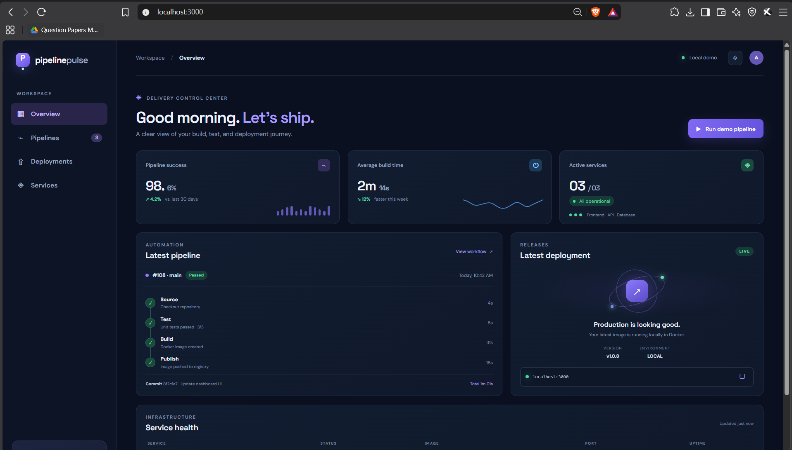
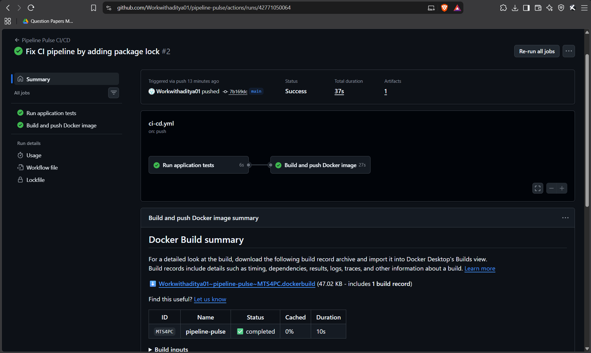
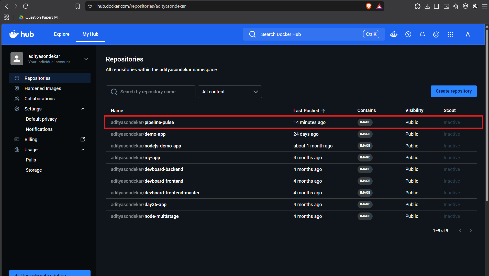
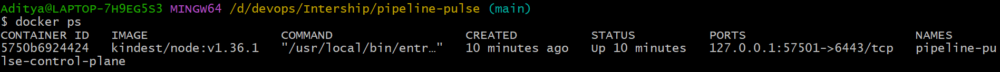
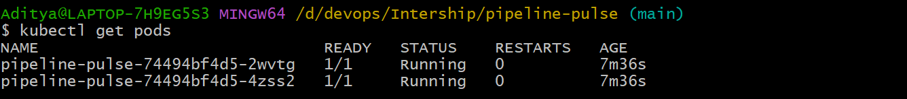
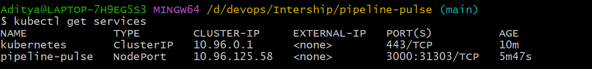

# Pipeline Pulse — CI/CD with GitHub Actions, Docker & kind


Pipeline Pulse is a small Node.js dashboard app built to demonstrate a **complete CI/CD pipeline with no cloud spend**. Every push to `main` triggers GitHub Actions, which runs the tests, builds a Docker image, and pushes it to Docker Hub. The published image is then pulled and run locally with Docker or on a local [kind](https://kind.sigs.k8s.io/) (Kubernetes in Docker) cluster.

## Project Links

| Deliverable | Link |
|---|---|
| GitHub repository | https://github.com/Workwithaditya01/pipeline-pulse |
| Docker image | https://hub.docker.com/r/adityasondekar/pipeline-pulse |
| CI/CD workflow runs | https://github.com/Workwithaditya01/pipeline-pulse/actions |

## Objective

Set up a full CI/CD pipeline that builds a Docker image, runs tests, and deploys locally.

**Tools used:** GitHub Actions, Docker, Docker Compose, Docker Hub (free tier), kind, kubectl

## Architecture

```text
Developer push / pull request
            |
            v
      GitHub Actions
            |
        Run tests
            |
       Tests pass?
        /      \
      no        yes
      |          |
   Stop      Build image
                 |
        Push (main branch only)
                 |
             Docker Hub
                 |
        Pull image locally
          /            \
   Docker run          kind
 (localhost:3000)   (2 replicas, NodePort)
```

## Features

- Responsive dark dashboard UI served by a dependency-free Node.js HTTP server
- `/health` endpoint returning a JSON status, used by Docker and Kubernetes health checks
- 3 automated tests using Node's built-in test runner (`node --test`)
- Dockerfile based on `node:22-alpine`, runs as a **non-root user**, with a built-in `HEALTHCHECK`
- `docker-compose.yml` for one-command local deployment
- GitHub Actions workflow: tests on every push and pull request; image publish only on pushes to `main`
- Kubernetes manifests (`deployment.yaml`, `service.yaml`) with 2 replicas and a readiness probe

## Project Structure

```text
pipeline-pulse/
├── .github/workflows/ci-cd.yml   # GitHub Actions pipeline
├── public/                       # Frontend (index.html, styles.css, app.js)
├── tests/server.test.js          # Automated tests
├── server.js                     # Node.js HTTP server
├── Dockerfile                    # Container image definition
├── docker-compose.yml            # Local deployment
├── deployment.yaml               # Kubernetes Deployment (kind)
├── service.yaml                  # Kubernetes Service (NodePort)
├── package.json
└── Pipeline-pulse/               # Deployment screenshots
```

## CI/CD Pipeline

The workflow in `.github/workflows/ci-cd.yml` has two jobs:

| Job | Runs on | What it does |
|---|---|---|
| **Run application tests** | push, pull request, manual | Checks out code, sets up Node.js 22, runs `npm ci` and `npm test` |
| **Build and push Docker image** | push to `main` only, after tests pass | Logs in to Docker Hub, builds the image with Buildx, pushes `latest` and a commit-SHA tag |

```workflow

name: Pipeline Pulse CI/CD

on:
  push:
    branches: [main]

  pull_request:
    branches: [main]

  workflow_dispatch:

jobs:
  # Job 1: Run application tests
  test:
    name: Run application tests
    runs-on: ubuntu-latest

    steps:
      - name: Check out repository
        uses: actions/checkout@v4

      - name: Set up Node.js
        uses: actions/setup-node@v4
        with:
          node-version: 22

      - name: Install dependencies
        run: npm ci

      - name: Run tests
        run: npm test

  # Job 2: Build and push Docker image
  build-and-push:
    name: Build and push Docker image
    needs: test
    if: github.event_name == 'push' && github.ref == 'refs/heads/main'
    runs-on: ubuntu-latest

    steps:
      - name: Check out repository
        uses: actions/checkout@v4

      - name: Set up Docker Buildx
        uses: docker/setup-buildx-action@v3

      - name: Log in to Docker Hub
        uses: docker/login-action@v3
        with:
          username: ${{ secrets.DOCKERHUB_USERNAME }}
          password: ${{ secrets.DOCKERHUB_TOKEN }}

      - name: Build and push image
        uses: docker/build-push-action@v6
        with:
          context: .
          push: true
          tags: |
            ${{ secrets.DOCKERHUB_USERNAME }}/pipeline-pulse:latest
            ${{ secrets.DOCKERHUB_USERNAME }}/pipeline-pulse:${{ github.sha }}

```

### Required GitHub secrets

Add these under **Settings → Secrets and variables → Actions**:

| Secret | Value |
|---|---|
| `DOCKERHUB_USERNAME` | Your Docker Hub username |
| `DOCKERHUB_TOKEN` | A Docker Hub access token with Read & Write access (not your password) |

## Requirements

- Git and a GitHub account
- Node.js 22+ (for running tests locally)
- Docker Desktop, or Docker Engine with the Compose plugin
- A free Docker Hub account
- [kind](https://kind.sigs.k8s.io/) and `kubectl` (for the Kubernetes deployment)

## Getting Started

### 1. Run locally without Docker

```bash
npm test
npm start
```

Open <http://localhost:3000>. Health check: <http://localhost:3000/health>

### 2. Run with Docker Compose

```bash
docker compose up --build -d
docker compose ps
```

Open <http://localhost:3000>. Other useful commands:

```bash
docker compose logs -f
docker compose down
```

### 3. Pull and run the published image from Docker Hub

```bash
docker pull adityasondekar/pipeline-pulse:latest
docker run -d --name pipeline-pulse -p 3000:3000 --restart unless-stopped adityasondekar/pipeline-pulse:latest
docker ps
```

Check container health and clean up:

```bash
docker inspect --format='{{.State.Health.Status}}' pipeline-pulse
docker rm -f pipeline-pulse
```

### 4. Deploy to a local Kubernetes cluster with kind

```bash
kind create cluster --name pipeline-pulse
kubectl apply -f deployment.yaml
kubectl apply -f service.yaml
kubectl get pods
kubectl get services
```

The Deployment runs **2 replicas** of `adityasondekar/pipeline-pulse:latest` and uses `/health` as its readiness probe. The Service exposes the app as a `NodePort` on port 3000.

kind runs the cluster inside a Docker container, so the NodePort is not reachable directly from your host. Forward the service port to access the app:

```bash
kubectl port-forward service/pipeline-pulse 3000:3000
```

Open <http://localhost:3000>. Delete the cluster when you are done:

```bash
kind delete cluster --name pipeline-pulse
```

## Screenshots

### Deployed application


### GitHub Actions workflow results


### Docker Hub image


### Running container (`docker ps`)


### kind deployment



## Troubleshooting

- **Port 3000 already in use:** change the left side of the port mapping (e.g. `3001:3000`) and open `http://localhost:3001`.
- **Docker daemon not running:** start Docker Desktop or the Docker service and retry.
- **Docker Hub login fails in CI:** make sure `DOCKERHUB_TOKEN` is an access token, not your account password.
- **Image push denied:** verify the username, token permissions, and repository name.
- **Workflow doesn't publish:** confirm you pushed to `main`, the test job passed, and both secrets exist.
- **`npm ci` fails in CI:** make sure `package-lock.json` is committed.
- **Pods not ready in kind:** run `kubectl describe pod <pod-name>` and check that the image can be pulled.
- **App not reachable after deploying to kind:** NodePorts are not exposed to the host by default; use `kubectl port-forward service/pipeline-pulse 3000:3000`.

## Deliverables Checklist

- [x] GitHub repo with workflows
- [x] Docker image on Docker Hub
- [x] CI/CD workflow results
- [x] Screenshots of the deployed app

## Author

**Aditya Sondekar** — DevOps Intern, Elevate Labs
GitHub: [@Workwithaditya01](https://github.com/Workwithaditya01) · Docker Hub: [adityasondekar](https://hub.docker.com/u/adityasondekar)
